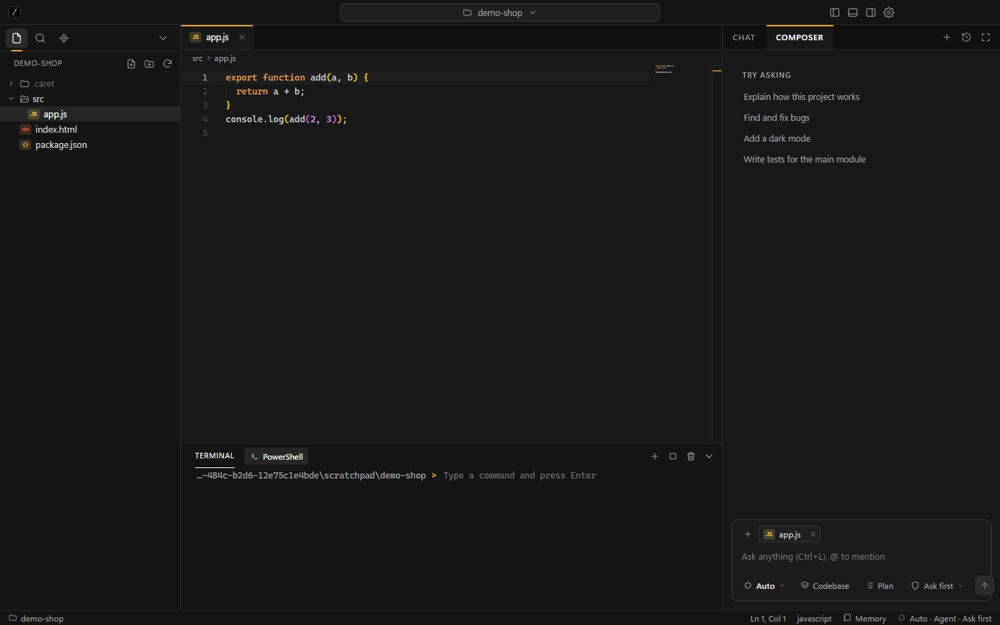

  

<h1 align="center">Caret Agent</h1>

  <b>An AI code editor that never forgets what you were doing — even when you switch AI.</b> 
  Free. Local-first. Works with Claude, Codex, Grok, Gemini and the models already on your computer.

  

---

## The problem

You start a feature with Claude. The limit runs out. You move to ChatGPT, or a local model, and spend the next ten minutes explaining the whole project again.

**Caret Agent fixes that.** Every AI that works in your project reads and writes one shared note, `.caret/HANDOFF.md`: what the project is, what is done, what is half-finished, and what to do next. Change the AI whenever you like. The next one picks up exactly where the last one stopped.

## What you get

**One memory, any AI**
Claude, Codex, Grok, Gemini or a model running on your own machine — they all share the same project note. After every turn Caret Agent also logs what happened, so the note stays honest even if an AI forgets to update it.

**Free local models, picked for you**
Already have Ollama, LM Studio or llama.cpp? Caret Agent finds your models and chooses the best one for the task and your hardware: it checks GPU and RAM, whether the model can use tools, whether it can see images, and how big it is. Nothing to configure and nothing to upgrade — there is no paid tier.

**You decide how much the AI may do**
- **Ask first** — every edit and every command waits for your OK, with a preview of what will change.
- **Decide for me** — normal edits and commands just run. Deleting things, pushing code, installing globally, reaching other machines, or touching files outside the project still asks.
- **Full access** — nothing asks. The AI is still locked inside your project folder.

**Three ways to work**
- **Plan** — reads your code and writes a plan to `.caret/PLAN.md`. Changes nothing.
- **Code** — makes the change you asked for, then stops.
- **Agent** — works on its own: writes, runs, checks, fixes, and only stops when it works.

**Built-in terminal the AI can use**
The AI runs commands in the same terminal you see, marked so you know which ones were its. It can start a dev server, and any `localhost` address it prints becomes a button that opens a live preview.

**Many chats at once**
Open as many AI tabs as you want, each with its own model, mode and permission. Run Claude on the backend in one tab while a local model works on the styles in another.

**Paste a screenshot, get a fix**
Copy an image and paste it straight into the prompt box. Drag-and-drop works too. Models that can see images read it; if your chosen model cannot, Auto switches to one that can.

**Interfaces that don't look machine-made**
Every AI reads `.caret/DESIGN.md` before it builds a screen: a calm colour system, a spacing scale, a list of things never to do (purple gradients, glass cards, emoji icons, three-box feature grids). Every web page it creates ships with a logo and favicon. Edit the file to match your own taste.

**Two views, your choice**

| Studio | Agent |
|---|---|
| A full code editor — the same engine as VS Code — with files, terminal and AI chat side by side. | Chat first. Describe what you want and watch it get built, with your files on the side. |
|  |  |

## Made for many people, not one

- **Your own sign-in.** Claude and Codex run through the command-line tools you already have signed in. Caret Agent never sees or stores those logins.
- **Keys stay encrypted.** Grok, Gemini and OpenAI keys are saved with your operating system's secure storage and are never sent to the page.
- **Works on a fresh machine.** It finds tools even when the desktop doesn't inherit your shell settings, runs without Node installed, and starts Ollama for you if it isn't running.
- **Any language, any folder.** Thai, English and anything else. Open a folder or clone a repository on first launch.
- **Setup in a minute.** The first run asks what you do and which view you want, and shows what AI it found on your computer.

## Safe by design

An AI that can edit files and run commands has to be treated as untrusted. Caret Agent assumes the AI can be wrong, or can be tricked by text inside a file or web page.

- Every file operation is confined to the open folder, including paths that try `../` or follow links out of it. `.git` is read-only, so nothing can plant a hook.
- Deletes go to the recycle bin, not into the void.
- Risky commands are recognised and always ask in *Decide for me* mode.
- The AI is told that file contents and command output are data, never instructions.
- The window runs with Node disabled, a sandbox, context isolation and a strict content-security policy. The page can only call a short, fixed list of functions, and every call is checked to come from the app's own page.
- Claude's tool requests go through a local, token-protected channel so your permission setting applies to it too.
- Cloning only accepts `https://` and `git@` addresses and cannot be turned into a git option.

These rules are covered by automated checks (`npm run check`) that try path escapes, links, `.git` writes, command patterns and hostile clone addresses.

## Status

Caret Agent is early. What has been exercised end to end: the editor, file tree, terminal, onboarding, both views, model discovery on a real machine, the permission and path-safety rules, and full agent runs that wrote a page with a logo and updated the shared project note with a local model (Ollama), with Claude Code and with Codex, including the Allow / Deny prompts for Claude's file edits.

Wired up but **not yet tested with a real account or server**: Grok / Gemini / OpenAI with API keys, and LM Studio and llama.cpp (their streaming format is covered by an automated check against a mock server). Antigravity is not connected yet. Local models on modest hardware can be slow — an 8B model can take several minutes for one task, while a 4B model finished a small file edit in under a minute. Expect rough edges and please open an issue when you find one.

Windows is the main target today. macOS and Linux code paths exist but have had less testing.

## Contributing

Issues and pull requests are welcome. Good first areas: more language servers in the editor, a Git panel, diff view for AI edits, and more local runtimes.

## License

MIT
