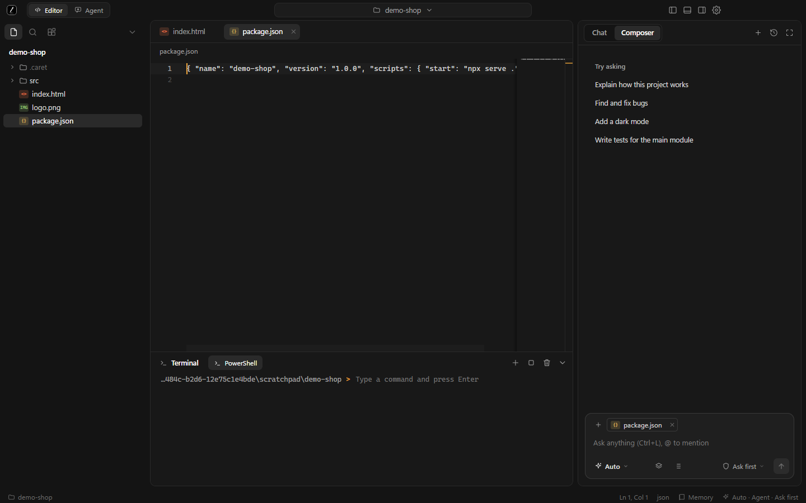
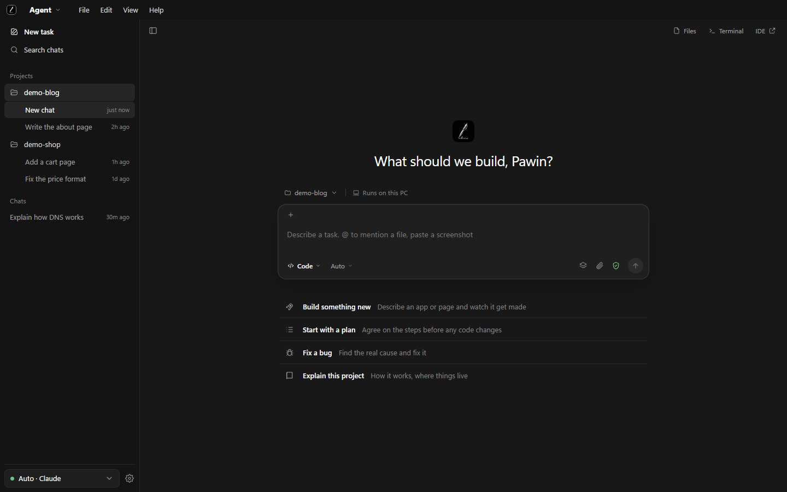

<p align="center">
  
</p>

<h1 align="center">Caret Agent</h1>

<p align="center">
  <b>A desktop AI agent and code editor that never forgets what you were doing — even when you switch AI.</b><br>
  Free. Your files stay on your computer. Works with Claude Code, Codex, Grok, Antigravity (Gemini) and ChatGPT.
</p>

<p align="center">
  
</p>

---

## Free, forever

Caret Agent costs nothing. No subscription, no account, no trial, no ads. It is MIT-licensed, so you can read, change and share every line.

You only pay the AI companies directly for what you already use (your Claude or ChatGPT plan, or an API key). Caret Agent never sits in the middle and never takes a cut. Your code stays on your computer.

## Download

1. Go to the [**latest release**](https://github.com/plawanpawin-byte/Caret-Agent/releases/latest) and download `Caret Agent Setup 0.1.3.exe` (Windows, about 92 MB).
2. Run it and follow the installer.
3. Windows may show a blue "Windows protected your PC" box because the installer is not code-signed yet. Click **More info**, then **Run anyway**.

Prefer to run from source? You need Node.js installed:

```bash
git clone https://github.com/plawanpawin-byte/Caret-Agent.git
cd Caret-Agent
npm install
npm start
```

## How to use it

1. **Start a chat or a project.** In the Agent view, **New task** opens a normal chat that belongs to no project. To work on code, click the folder-plus button next to **Projects** and choose a folder: that folder is the project. Press **+** on a project to start a new conversation in it; each project keeps its own chat history. You can also clone a repository, and switch between IDE and Agent from the menu at the top left.
2. **Pick an AI.** Open the model menu in the prompt bar. If Claude Code or Codex is already signed in on your computer, it shows up ready to use. For Grok, Gemini or ChatGPT paste an API key; it is checked and stored encrypted.
3. **Choose a mode and a permission.** Plan, Code or Agent decides what the AI does. Ask first, Decide for me or Full access decides how much it may do without asking.
4. **Describe the task.** Type what you want, use `@` to mention a file, or paste a screenshot. Watch it read, edit and run commands.
5. **Switch AI when you need to.** Hit a limit? Pick another model in the same chat. It reads `.caret/HANDOFF.md` and carries on. Nothing to re-explain.
6. **Stop any time.** The white stop button in the prompt bar ends the run. When the AI finishes, the chat stops showing "Working…" by itself.

## Extensions

Open **Extensions** (in the Agent side bar, the menu, or the command palette) to add more power to Claude Code without leaving the app. Search, filter by MCP, Skills or Tools, read what each one does, and press **Install**. Nothing sends you to a web page.

- **GitHub** MCP: read repositories, issues, pull requests and Actions runs.
- **Superpowers**: a plan-first, test-first development method for your agent.
- **aislop**: catches the leftovers AI agents write (dead code, swallowed errors).
- **REA**: reverse engineer how an app works.
- **Roblox Studio** MCP: build and edit a Roblox game from the chat (needs Roblox Studio).

## Task lists

Give the AI a job and it first splits your request into short tasks, such as "Create the HTML page", "Style it", "Push to GitHub", and ticks them off as it works.

## Sign-in

The first launch asks you to **Continue with GitHub**. It opens the Carnet website in your browser and, once you sign in there, the app is signed in too. The website only learns your GitHub username.

## Why use it

- **Never re-explain your project.** One shared memory file works across every AI.
- **Never blocked by a limit.** Move to the next model in one click and keep going.
- **You stay in control.** Every edit can wait for your OK, with a preview of the change. Deletes go to the recycle bin.
- **Safe by default.** The AI is locked inside your project folder. Your keys are encrypted and never reach the page.
- **Better-looking results.** Built-in design rules keep generated pages from looking machine-made.
- **One place for everything.** Editor, terminal, live preview and AI chat in a single window.

---

## The problem

You start a feature with Claude. The limit runs out. You move to Codex or Grok, and spend the next ten minutes explaining the whole project again.

**Caret Agent fixes that.** Every AI that works in your project reads and writes one shared note, `.caret/HANDOFF.md`: what the project is, what is done, what is half-finished, and what to do next. Change the AI whenever you like. The next one picks up exactly where the last one stopped.

## What you get

**One memory, any AI**
Claude, Codex, Grok, Gemini or ChatGPT — they all share the same project note. After every turn Caret Agent also logs what happened, so the note stays honest even if an AI forgets to update it.

**Set up any AI from the model menu**
Open the model menu in the prompt bar and everything is there. Claude and Codex can run as an app on your computer (installed with one click, signed in through your browser) or through an API key, your choice. Grok and Antigravity (Gemini) connect with an API key. Each key is checked before it is saved and kept encrypted on your computer.

**You decide how much the AI may do**
- **Ask first** — every edit and every command waits for your OK, with a preview of what will change.
- **Decide for me** — normal edits and commands just run. Deleting things, pushing code, installing globally, reaching other machines, or touching files outside the project still asks.
- **Full access** — nothing asks. The AI is still locked inside your project folder.

**Three ways to work**
- **Plan** — reads your code and writes a plan to `.caret/PLAN.md`, changing nothing. When the plan is ready it asks whether to start coding it; with Full access it just carries on.
- **Code** — makes the change you asked for, then stops.
- **Agent** — works on its own: writes, runs, checks, fixes, and only stops when it works. If a command keeps failing, it is stopped instead of looping forever.

**Built-in terminal the AI can use**
The AI runs commands in the same terminal you see, marked so you know which ones were its. It can start a dev server, and any `localhost` address it prints becomes a button that opens a live preview.

**Many chats at once**
Open as many AI tabs as you want, each with its own model, mode and permission. Run Claude on the backend in one tab while Codex works on the styles in another.

**Paste a screenshot, get a fix**
Copy an image and paste it straight into the prompt box. Drag-and-drop works too. Models that can see images read it; if your chosen model cannot, Auto switches to one that can.

**Interfaces that don't look machine-made**
Every AI reads `.caret/DESIGN.md` before it builds a screen: a calm colour system, a spacing scale, a list of things never to do (purple gradients, glass cards, emoji icons, three-box feature grids). Every web page it creates ships with a logo and favicon. Edit the file to match your own taste.

**Two views, your choice**

| IDE | Agent |
|---|---|
| A full code editor — the same engine as VS Code — with files, terminal and AI chat side by side. | A desktop agent. Your projects and chats on the left, the conversation in the middle; files, terminal and the editor are one click away. |
|  |  |

## Made for many people, not one

- **Your own sign-in.** Claude and Codex run through the command-line tools you already have signed in. Caret Agent never sees or stores those logins.
- **Keys stay encrypted.** Grok, Gemini and OpenAI keys are saved with your operating system's secure storage and are never sent to the page.
- **Works on a fresh machine.** It finds tools even when the desktop doesn't inherit your shell settings, and runs without Node installed.
- **Any language, any folder.** Thai, English and anything else. Open a folder or clone a repository on first launch.
- **Setup in a minute.** The first run asks what you do and which view you want, and shows what AI it found on your computer.

## Safe by design

An AI that can edit files and run commands has to be treated as untrusted. Caret Agent assumes the AI can be wrong, or can be tricked by text inside a file or web page.

- Every file operation is confined to the open folder, including paths that try `../` or follow links out of it. `.git` is read-only, so nothing can plant a hook.
- Deletes go to the recycle bin, not into the void.
- Risky commands are recognised and always ask in *Decide for me* mode.
- The AI is told that file contents and command output are data, never instructions.
- The window runs with Node disabled, a sandbox, context isolation and a strict content-security policy. The page can only call a short, fixed list of functions, and every call is checked to come from the app's own page.
- Claude's tool requests go through a local, token-protected channel so your permission setting applies to it too.
- Cloning only accepts `https://` and `git@` addresses and cannot be turned into a git option.

These rules are covered by automated checks that try path escapes, links, `.git` writes, command patterns and hostile clone addresses.

## Status

Caret Agent is early. What has been exercised end to end: the editor, file tree, terminal, onboarding, both views, the permission and path-safety rules, and full agent runs with Claude Code and with Codex, including the Allow / Deny prompts for Claude's file edits.

Wired up but **not yet tested with a real account**: Grok, Antigravity (Gemini) and ChatGPT with API keys. Models that run on your own computer (Ollama, LM Studio, llama.cpp) are switched off for now: small ones were too unreliable at changing real code. Expect rough edges and please open an issue when you find one.

Windows is the main target today. macOS and Linux code paths exist but have had less testing.

## Contributing

Issues and pull requests are welcome. Good first areas: more language servers in the editor, a Git panel, diff view for AI edits, and more AI providers.

## License

MIT
